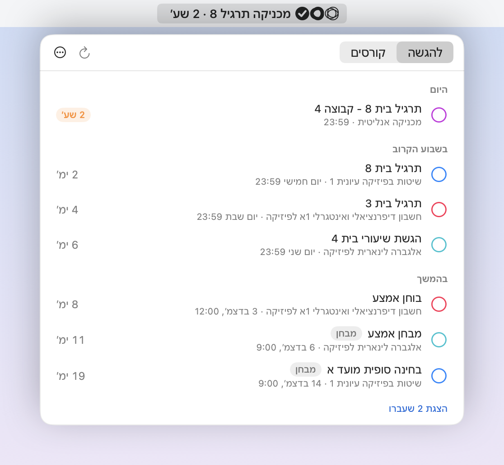
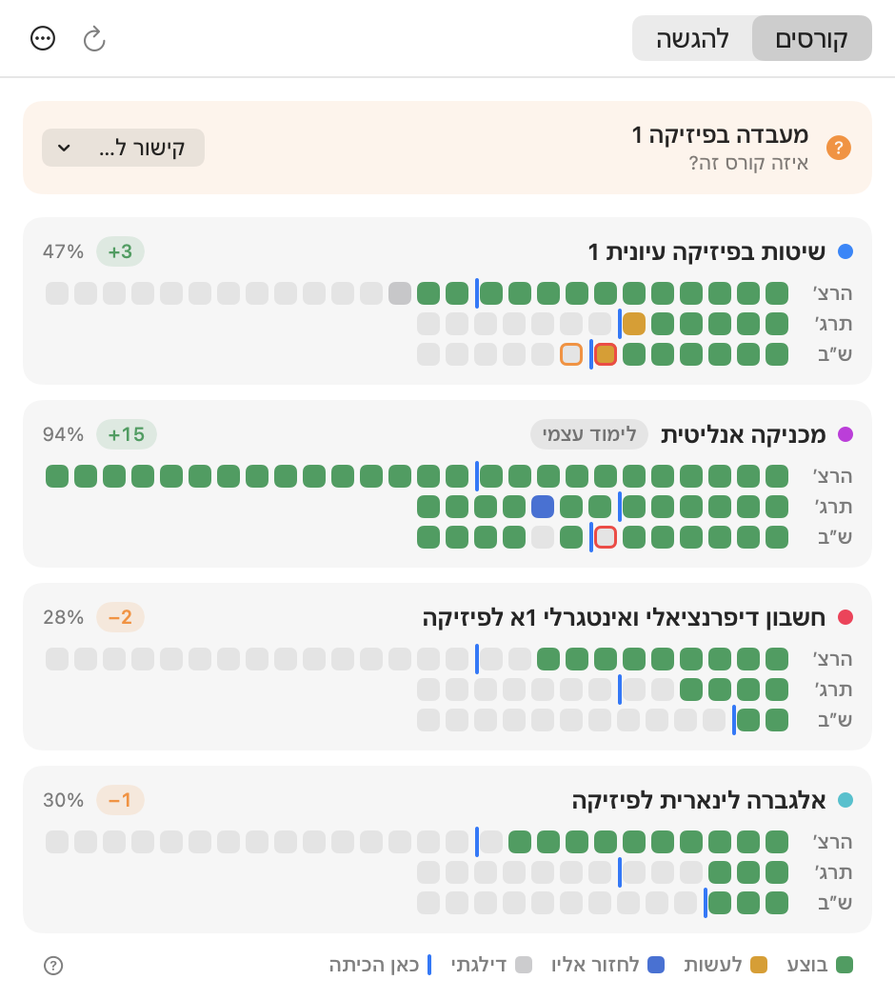
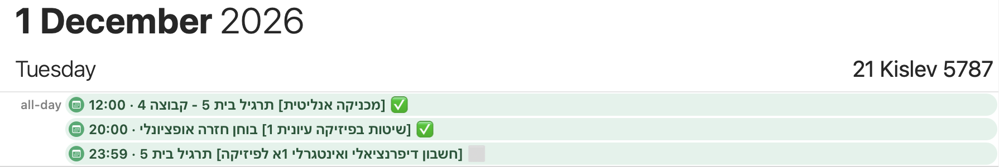

  <picture>
    <source media="(prefers-color-scheme: dark)" srcset="assets/logo-dark.png">
    
  </picture>

# TAUdo

A macOS menu bar companion for Tel Aviv University students. It shows your Moodle deadlines and your progress in each course, and reminds you before things are due. Hebrew by default, with an English option.

**Lives in the menu bar:** the next deadline at a glance, everything that's due one click away.

  <picture>
    <source media="(prefers-color-scheme: dark)" srcset="assets/screenshots/menubar-he-dark.png">
    
  </picture>

**Tracks each course:** lectures, recitations and homework, and how far ahead or behind the class you are.

  <picture>
    <source media="(prefers-color-scheme: dark)" srcset="assets/screenshots/panel-courses-he-dark.png">
    
  </picture>

**Syncs to your calendar:** each deadline as an all-day event with its due time and a done mark, in Apple Calendar or Google Calendar.

  

## Privacy

- TAUdo runs on your Mac. There is no TAUdo server and no account. It connects to:
  - Moodle, for your calendar export link.
  - [arazim-project.com](https://arazim-project.com), to download the semester's public course list for exam dates. Nothing about you is sent.
  - GitHub, to check for updates.
- With calendar sync on, your deadlines go into the calendar you pick, and so to iCloud or Google if that calendar lives there.
- It never sees your TAU password or your browser session.
  - Deadlines come from Moodle's calendar export link.
  - Submission status and course downloads come from the bookmark, which runs in your own logged-in browser tab.
- Your data stays in `~/Library/Application Support/TAUdo/state.json`, readable only by you, since the calendar link is a key to your Moodle calendar.
- The bookmark carries a secret tied to your copy of TAUdo, so other web pages can't send it data.

## How the Moodle parts work

| What | How | Needs |
|---|---|---|
| Deadlines | Moodle's iCal export (`calendar/export_execute.php`), fetched hourly, on wake, and when you open the panel | Only the link |
| Submitted assignments | Assignments due from two weeks ago on that are no longer on Moodle's to-do list (`core_calendar_get_action_events_by_timesort`) are checked on their own page: only `Submitted for grading` counts | A click on the bookmark while logged in |
| Lecture recordings | Each enrolled course's Panopto block (`block_panopto_get_content`), asked for its recordings. Cubes open them in Panopto by session number (`הרצאה 5`, `תרגול 07`, `07 - …`); the rest are listed on the course | A click on the bookmark while logged in |
| Course files | Moodle's *Download course content* zip if the course allows it. Otherwise `core_courseformat_get_state`, which gives files as `mod/resource/view.php?redirect=1` and folders as `download_folder.php` zips, plus files linked in section text | A click on the bookmark on the course page |

Some details:
- Homework deadlines are matched to cubes by course and number (`תרגיל בית 3`, `הגשת שיעורי בית 3`, `HW 3`, `Problem Set 3`, …).
- Moodle courses are linked to your courses by name, or by the TAU course code if it appears in the course's files.
- Moodle's export only looks back a few days, so TAUdo keeps this semester's past events.
- Moodle's export has no links. The bookmark also sends each event's activity page from Moodle's calendar (`core_calendar_get_calendar_monthly_view`), so *Open in Moodle* on a deadline or homework cube goes there; before that, it opens Moodle's calendar on the due date.
- An assignment also leaves the to-do list when its completion condition (e.g. viewing it) is met, hence the check on its page. Untick a deadline to override; TAUdo never re-applies the same report.
- TAU Moodle opens in guest mode, and guests get a session too. The bookmark only runs on pages with a logout link, and TAUdo ignores guest export links (`userid=1`).

## License

The code is under the [MIT License](LICENSE). The ring shapes in the logo come from Tel Aviv University's logo and are not covered by it.

TAUdo is not affiliated with or endorsed by Tel Aviv University. The TAU logo and name are the university's trademarks.
